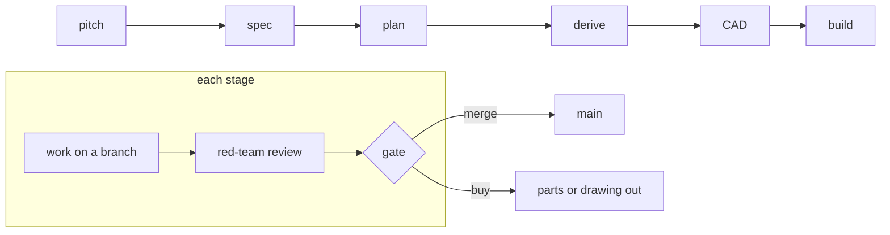
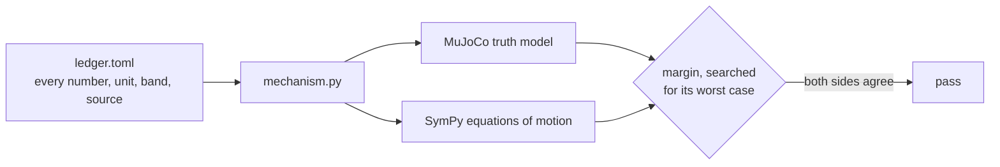

# Armature

A Claude Code plugin for designing robots. It takes a project from idea to CAD, checks the dynamics against a MuJoCo model, and won't merge or buy anything until a red-team review is closed.

## How a project runs



Every stage works on a branch. The `merge` gate needs a red-team review with its BLOCKERs and MAJORs closed and a passing model. The `buy` gate also needs every ordered part confirmed by you and priced in the last 90 days. A plugin hook blocks a merge the gate would refuse. You can waive a gate item in `waivers.toml`, with a reason.

## How the math is checked



- You describe the mechanism once. The engine compiles it to a MuJoCo model and to symbolic equations of motion, so the derivation is checked against an independent model.
- Each margin is searched over posture, load and every tolerance band, not read at one chosen point.
- Motors, drivers and the DC bus are sized from a simulated mission (moves, holds, e-stops), including winding temperature and bus voltage under regeneration.
- Every input number lives once in `ledger.toml`. Budgets, the BOM and the requirements table are generated from it.

The engine is the Python package in [`engine/`](engine/). The plugin is tested on six mechanisms with known answers and planted mistakes, and a release is blocked unless the agent catches them ([`evals/`](evals/README.md)).

## Quick start

You need [`gh`](https://cli.github.com/) (logged in) and [uv](https://docs.astral.sh/uv/).

```
/plugin marketplace add rioharper/armature
/plugin install armature@armature-plugins
```

Run `/armature:init` in an empty folder. It sets up the project and the GitHub repo, then starts the pitch interview. After the pitch, ask Claude to chart a map: `armature-wayfind` breaks the work into decision tickets on GitHub Issues, and "work the map" picks the next one and runs the right skill.

## Skills and agents

| Use | For |
|---|---|
| `armature-pitch` | Who it's for and why it beats what exists |
| `armature-spec` | Spec, trade studies, BOM, budgets |
| `armature-plan` | Phased plan as GitHub issues, plus frames and symbols |
| `armature-derive` | Kinematics, dynamics, actuator sizing, as notes plus a Python model |
| `armature-cad` | Part definitions and build recipes, checked against the dynamics |
| `armature-wayfind` | Breaking a large or unclear effort into tickets |
| `armature-test` | Test-first robot software |
| `armature-bringup` | Bench test procedures and their records |
| `/armature:armature-debug` | Hardware misbehaving at the bench |
| `armature-teach` | Explaining a concept or design decision |
| red-team (agent) | Adversarial review before a merge or purchase |
| librarian (agent) | Datasheets, prices, vendor CAD models |
| inventor (agent) | Less conventional mechanisms and actuators |

Only `/armature:init` and `/armature:armature-debug` have to be typed. The rest start on their own.

## Example output

From the Ibex rover, a squatting camera platform built with Armature:

| | |
|---|---|
|  |  |


## Optional CAD tools

- **SolidWorks MCP** (Windows): say yes in `/armature:init`. It measures the live model (mass properties, rebuilds, dimensions) for `armature-cad` to check. Re-run init after a plugin update. See `mcp/solidworks/`.
- **build123d recipes**: `armature-cad` can write each part as a [build123d](https://github.com/gumyr/build123d) script to check mass, inertia and interference before you open CAD. Run them all with `uv run --project analysis/model --with 'build123d~=0.11' python cad/parts/run_all.py`.

## Notes

- The project's model pins the engine by the plugin's release tag, so its first `uv sync` needs GitHub access.
- The gates' first run builds an environment in 15–30 s. After that a merge check takes about 6 s.
- The hook only acts in a folder whose root holds `ledger.toml`.
- Design decisions are in [`docs/adr/`](docs/adr/), release notes in [`CHANGELOG.md`](CHANGELOG.md).

## Credits

Several skills and conventions adapt [Matt Pocock's skills](https://github.com/mattpocock/skills) (MIT). See [`NOTICE.md`](NOTICE.md).
